# Jornada completa do Pediu

Relatório para o dono do produto. Data do teste: 18 de outubro de 2026.

O Pediu foi aberto de ponta a ponta, com lojas, cardápios e entregadores de mentira, no mesmo computador em que o programa roda. A tela foi a largura de um celular (390 por 844). Não havia emulador de Android nesta máquina, então isto não é o APK no bolso de uma pessoa. Onde o comportamento depende do celular de verdade (GPS em segundo plano, som de pedido, aviso com o app fechado), o texto diz o que a tela fez aqui e o que o programa está preparado para fazer no telefone.

Três contas andaram juntas no **pedido 2**: a cliente Ana, a Pizzaria Forno da Vila e o motoboy Carlos. Um quarto papel, a administração, aprovou outro motoboy e gerou código de senha.

**Veredito geral: não pronto para um piloto com pessoas reais na cidade.**

Dá para completar um pedido quando o endereço já tem um ponto no mapa, a loja está aberta e o motoboy já está vinculado e online. Uma pessoa nova, no primeiro dia, emperra antes disso. O motoboy, que é a parte mais sensível de um delivery, não tem o que o iFood Entregas, a Rappi, a 99Food, a Uber Eats ou a Loggi mostram numa corrida: tempo para aceitar, distância, valor que ele recebe, mapa até a loja, mapa até o cliente, confirmação de retirada, código ou foto na porta, e dinheiro contado.

---

## Como ler os vereditos

- **Pronto:** uma pessoa comum consegue fazer aquilo sem ajuda e sem susto.
- **Quase:** o caminho existe, mas falta clareza, aviso ou um pedaço que o concorrente já resolve.
- **Não pronto:** a pessoa se perde, vê informação errada, ou a operação não fecha.

As prioridades no fim são:

- **Bloqueia piloto:** não coloque cliente, loja ou motoboy de verdade até isso mudar.
- **Importante:** o piloto até anda, mas gera reclamação, atraso ou desconfiança.
- **Melhoria:** pode esperar a segunda leva.

---

## O que aconteceu no pedido de verdade

1. A Ana, que já tinha o endereço de casa com ponto no mapa, colocou uma pizza margherita no carrinho (R$ 42,00 mais R$ 6,90 de entrega, total R$ 48,90) e pagou em dinheiro.
2. A pizzaria viu o pedido na fila, aceitou, começou o preparo e marcou como pronto.
3. O Carlos tocou em Offline e ficou online. A loja chamou o Carlos pelo nome.
4. O Carlos viu a oferta, aceitou, compartilhou a localização e tocou em confirmar entrega.
5. A Ana viu o pedido como entregue. O Carlos continuou vendo a entrega aberta, com uma frase de erro de programa na tela.

Um pedido anterior da Ana, o número 1, ficou esperando a loja e **sumiu sozinho depois de 30 minutos**. Na tela dela só apareceu “Pedido cancelado”, sem dizer que a loja não aceitou a tempo.

---

## Consumidor

**Veredito: não pronto.**

A vitrine existe e a pessoa sem conta consegue olhar loja e produto. Fechar o primeiro pedido, entender o prazo e confiar no que está escrito ainda não está no nível de um iFood ou de uma Rappi.

### Primeira abertura

A primeira tela é o mascote com fome e quatro frases, com Continuar e Pular.

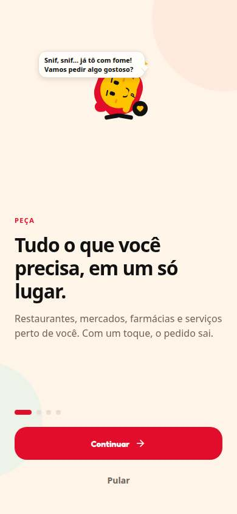

As frases prometem restaurante, mercado, farmácia e serviço, mapa ao vivo, chat com o entregador e anúncio feito por inteligência artificial. Farmácia não existe no cardápio de teste. O “mapa” da entrega é um quadro cinza com texto. O chat existe numa página que o acompanhamento não oferece. Anúncio com IA é um atalho da loja, não uma experiência do cliente.

**O que emperra:** tocar em Pular grava que a pessoa já viu a introdução e tenta abrir a vitrine. A mesma introdução puxa a pessoa de volta. Ela fica no laço até fechar o aplicativo e abrir de novo. No iFood a introdução aparece uma vez e a vitrine abre em seguida.

### Olhar sem conta

Depois de reabrir, a vitrine abre sem login. Dá para ver a Pizzaria Forno da Vila, o Lanche do Ponto, o Mercadinho Bom Preço e a Feijoada da Dona Lúcia. A Sushi da Rua estava fechada e **não apareceu**. Num app de delivery a loja fechada continua na lista, com o horário de abertura.

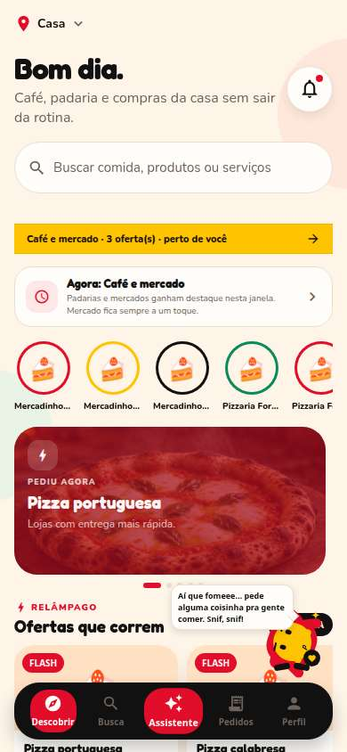

O que a pessoa vê no cartão da loja é um emoji de bolo, o nome, e de novo o nome. Não há nota, tempo, taxa, pedido mínimo nem “aberto agora”. O chip no topo diz “Casa” mesmo para quem nunca salvou endereço. Os banners falam em “até 25 min” e “entrega mais rápida” sem um prazo ligado àquela loja.

Buscar a palavra pizza devolve vazio: “Não encontramos esse pedido”. A pizzaria está no ar. O programa manda um filtro de preço de zero até zero e esconde tudo.

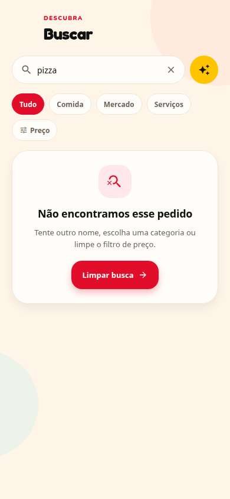

A página da loja lista as pizzas com preço. A página do produto usa um emoji de ferramenta no lugar da foto. Não há tamanho, borda, sabor extra nem observação rica. Dá para mudar a quantidade.

Tocar em adicionar ao carrinho sem conta abre um aviso: “Para continuar, entre no Pediu”, com Criar conta, Já tenho conta e Agora não. O item não entra no carrinho. Pedidos, suporte que abre chamado, favorito e perfil de verdade também pedem conta. A ajuda com quatro perguntas abre sem conta.

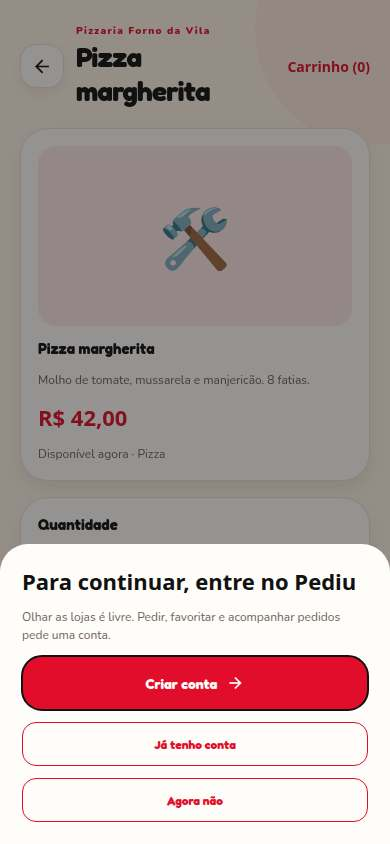

### Criar conta

O cadastro pergunta primeiro o papel: Cliente, Lojista ou Motoboy. Cliente pede nome, e-mail, telefone e senha. Isso está certo para o piloto.

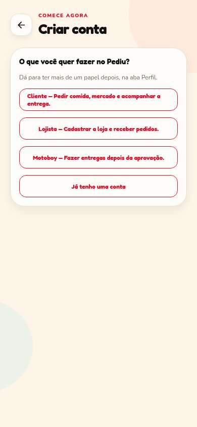

O perfil de quem já entrou mostra o nome, o e-mail, um número para a loja chamar, a seção de cliente e dois cartões: “Quero vender no Pediu” e “Quero ser entregador”.

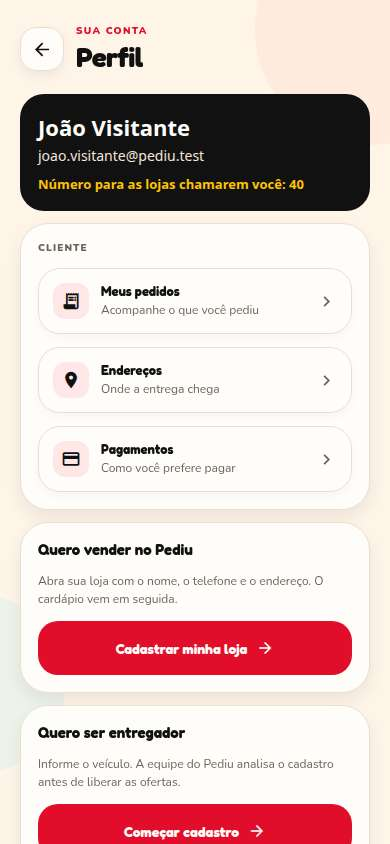

### Endereço e checkout

Quem digita um endereço de Pinheiros (rua, número, bairro, cidade, CEP) recebe: “Não achamos esse endereço no mapa”. Não há mapa para arrastar o pino. Sem pino, o checkout recusa a entrega. No iFood a pessoa confirma o pino no mapa e segue.

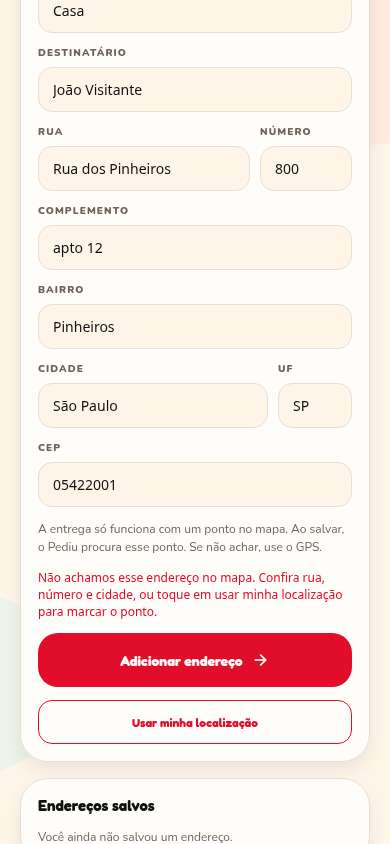

A Ana já tinha o endereço “Casa” com ponto. Com isso o checkout funcionou. A tela mostra subtotal, taxa de R$ 6,90 e total de R$ 48,90. O prazo é a frase “Prazo confirmado após o aceite”. Há entrega ou retirada, cupom, gorjeta e a escolha PIX ou dinheiro. Não há campo de troco. Não há pedido mínimo.

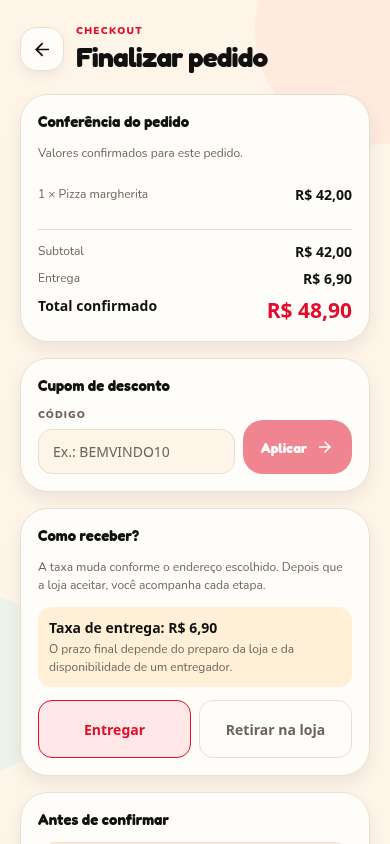

O pedido 2 foi confirmado em dinheiro. A tela de sucesso diz o número e o total. Não diz “pague R$ 48,90 em dinheiro ao entregador” nem pergunta “troco para quanto?”.

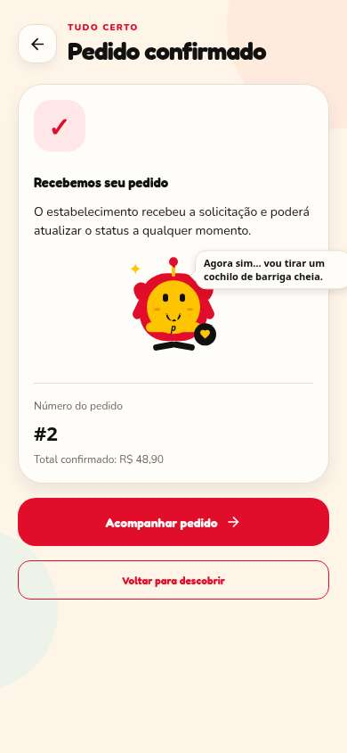

### Acompanhar, histórico, avaliação, ajuda

A aba Pedidos mostra o pedido, mas com texto quebrado, do jeito que um programador escreve fórmula: `` `PEDIDO #$2` ``, `` `Estabelecimento #$1` `` e `` `R$ $48,90` ``. A pessoa não vê o nome da pizzaria. Enquanto o pedido está pendente ou aceito, existe o botão Cancelar pedido. Depois que a cozinha começa a preparar, o botão some, como a regra do checkout descreve. A tela de acompanhamento não oferece cancelar.

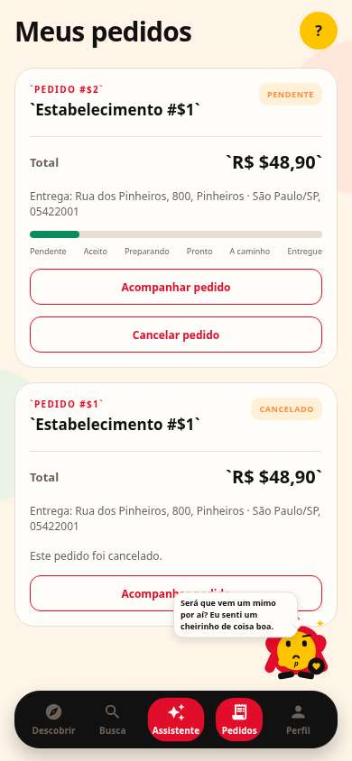

O pedido 1, cancelado sozinho, só diz “Este pedido foi cancelado”. Não explica o motivo.

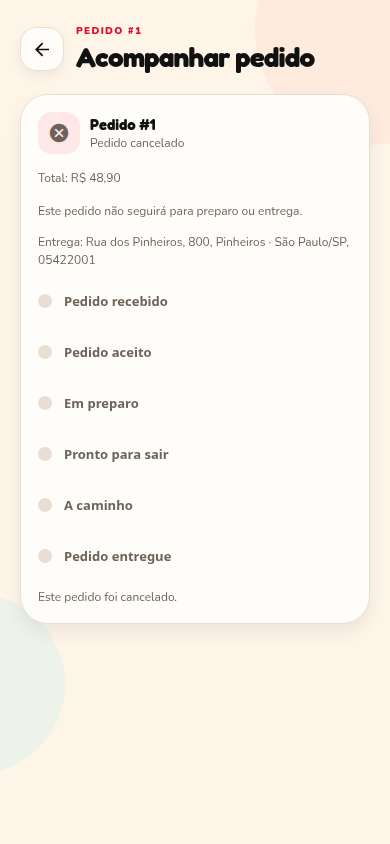

O pedido 2, no fim, mostra a linha do tempo até “Pedido entregue”. O botão “Acompanhar entrega” abre um quadro cinza. Aparece o nome do Carlos, o telefone e “posição atualizada recentemente”. Não há ruas, não há o bonequinho andando, não há botão para ligar.

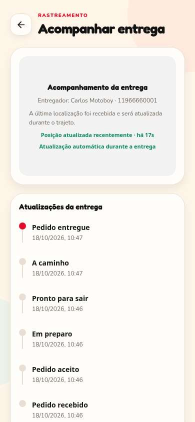

Existe uma tela de estrelas (loja, produto, entregador), mas o aplicativo não leva a pessoa até ela depois da entrega. Existe um chat do pedido, também sem atalho na tela de acompanhamento. A ajuda tem quatro respostas curtas e um botão para abrir chamado. O chamado pede assunto e mensagem. Não há WhatsApp, não há “meu pedido está atrasado” já preenchido.

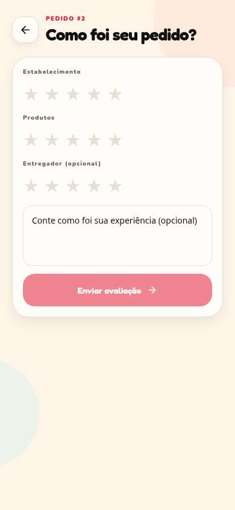

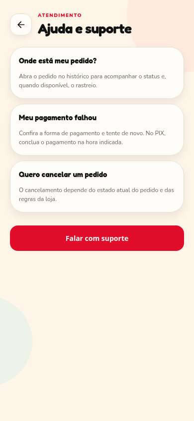

### Servidor dormindo

Com o servidor sem responder, a vitrine continua no ar com banners de “até 25 min”. Lá embaixo aparece “Não foi possível carregar o catálogo. Tente novamente em alguns instantes.” No plano gratuito da Render o servidor desliga depois de cerca de 15 minutos parado e a primeira abertura pode passar de meio minuto. A pessoa não é avisada de que o Pediu está acordando. Enquanto dorme, aviso de pedido e oferta para o motoboy também param, até o despertador chamar o servidor.

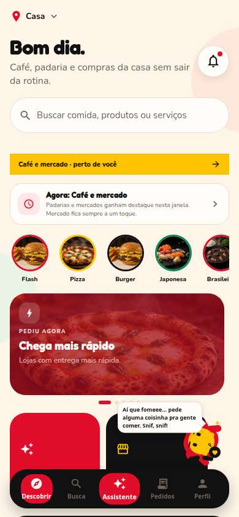

---

## Lojista

**Veredito: não pronto.**

Aceitar um pedido que já chegou e chamar um motoboy que já está na equipe funciona. Abrir uma loja nova, ser achado, ser avisado e saber quanto entrou no dia não funciona como numa operação de iFood ou Rappi.

### Cadastro

Quem escolhe Lojista informa a conta e, no passo seguinte, nome da loja, telefone e endereço. O botão é “Abrir minha loja”. Não há horário, raio desenhado no mapa, foto da fachada, CNPJ nem aprovação da equipe do Pediu. A loja pode aparecer para o público assim que esse passo termina.

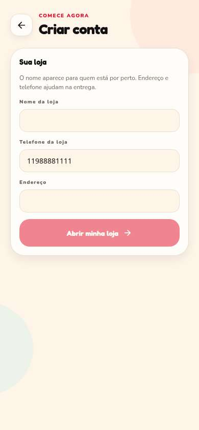

### Painel

O painel da pizzaria mostra “aberta”, pedidos na fila, no fogo e na bancada, e o valor vendido. No teste, com um pedido pendente, apareceu “1 pedidos pendentes” e “R$ 0,00 vendas registradas”. O pedido do aplicativo não entra na tela de vendas. Depois da entrega, Vendas continuou “Nenhuma venda registrada”.

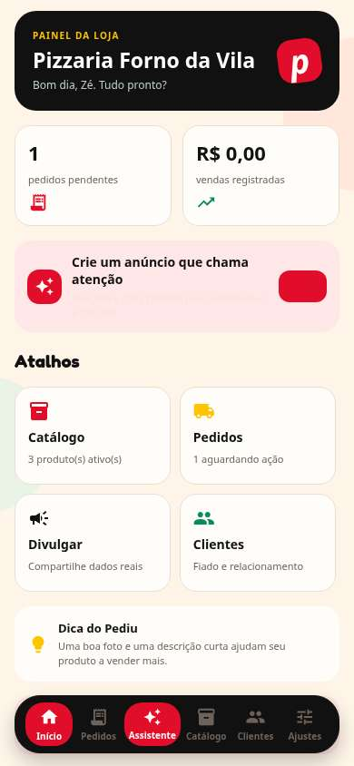

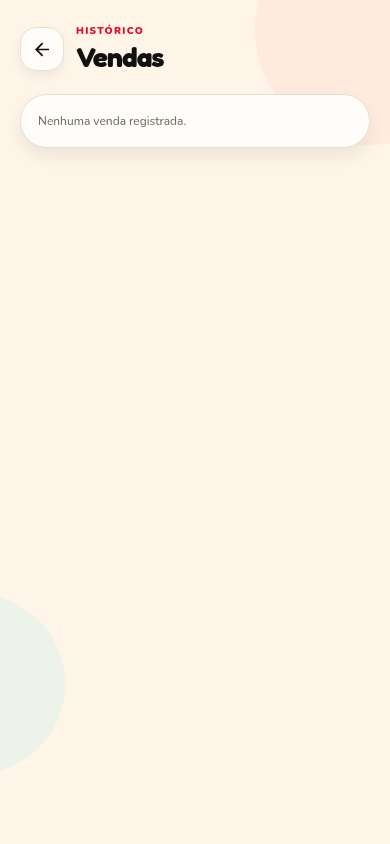

Não houve som nem aviso na tela quando o pedido 2 nasceu. No celular o programa tenta registrar um aviso da Expo, e no navegador esse passo é pulado. Não existe alarme de cozinha, daqueles que tocam até alguém aceitar, como no Gestor de Pedidos do iFood.

### Cardápio

Dá para publicar nome, categoria, descrição e preço, e ligar ou desligar o item. As três pizzas apareceram assim. Não há foto do produto, não há grupo de opções (broto ou grande, borda, adicional) e a dica da própria tela pede “uma boa foto”.

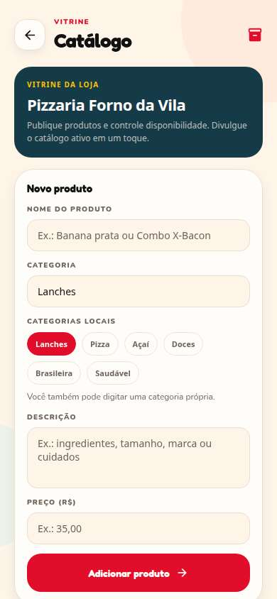

### Horário, área e pausa

Em Ajustes a loja edita nome, telefone, endereço em texto, chave PIX e taxa. Há um interruptor de delivery, outro de retirada, um campo de raio em quilômetros e **dois campos para digitar latitude e longitude**, com a frase “Use as coordenadas reais do estabelecimento”. Um dono de pizzaria não trabalha com coordenada. Não há horário de segunda a domingo. Pausar existe: o interruptor muda para “Loja fechada” e só vale depois de salvar. A loja fechada some da busca em vez de aparecer fechada.

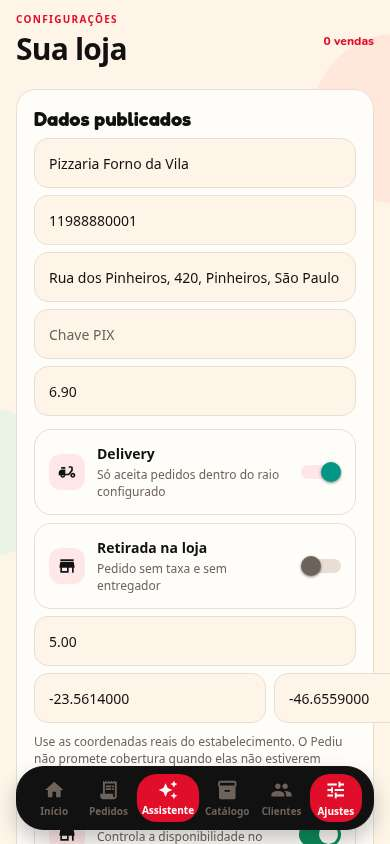

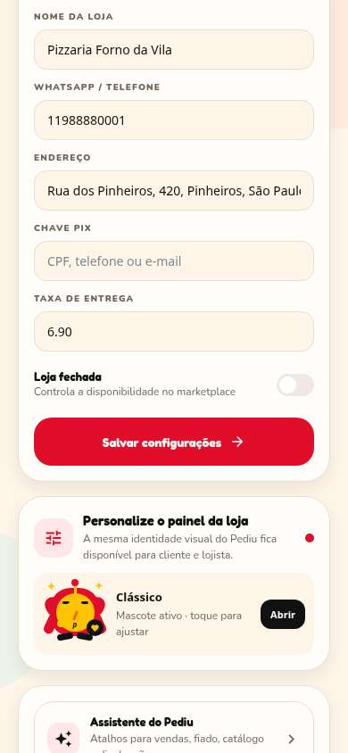

### Cozinha e motoboy

A fila mostrou o pedido 2, o endereço, R$ 48,90, Aceitar e Recusar. Aceitar passou para “Iniciar preparo”, depois “Marcar como pronto”. Não há tempo de preparo estimado para o cliente ver.

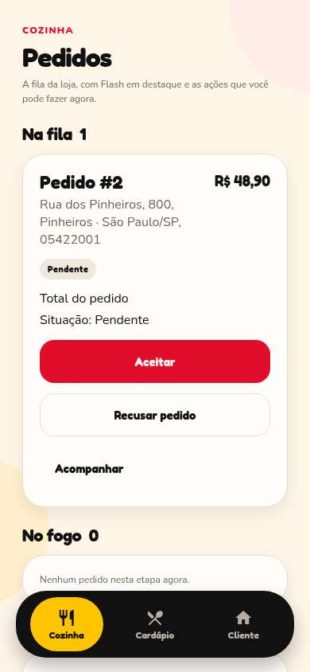

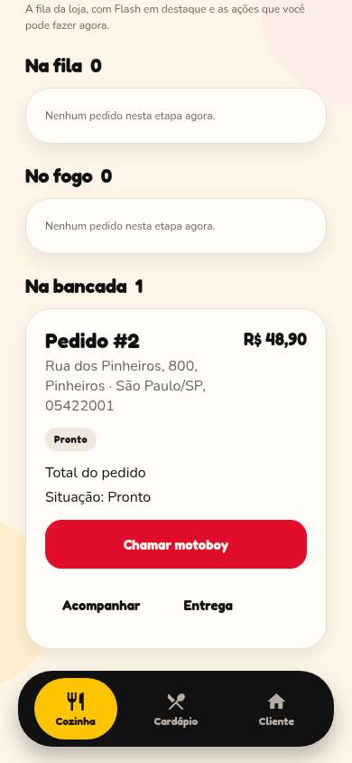

A equipe de entrega é uma lista. Para incluir alguém, a loja digita o número da conta do motoboy. O Carlos já estava vinculado.

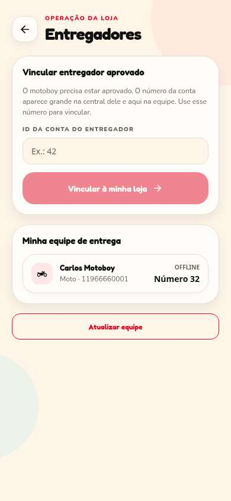

Chamar motoboy só funciona com o pedido em “Pronto” e com aquele motoboy aprovado, vinculado e online. A tela ofereceu “Chamar Carlos Motoboy · conta #32”. Não há “quem estiver perto”. Se o Carlos recusar ou estiver offline, a loja procura outro número. Depois do clique, a frase “Oferta enviada” apareceu.

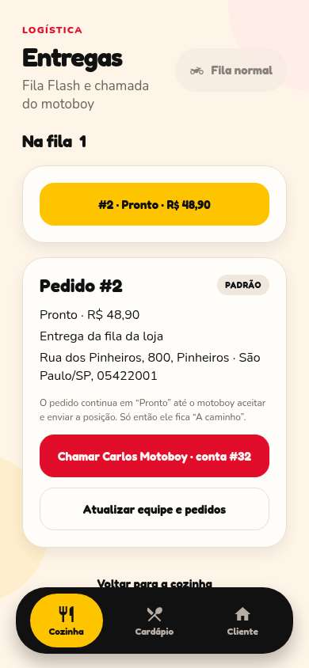

---

## Motoboy

**Veredito: não pronto.** Esta é a jornada mais distante de um app de entregas de verdade.

### Cadastro e aprovação

Quem escolhe Motoboy informa nome, e-mail, telefone e senha, depois bicicleta, moto ou carro, e a placa. O botão “Enviar para análise” leva a “Cadastro em análise” e libera olhar as lojas como cliente. Não pede CPF, CNH, foto do documento, foto do rosto, dados bancários nem tipo de baú.

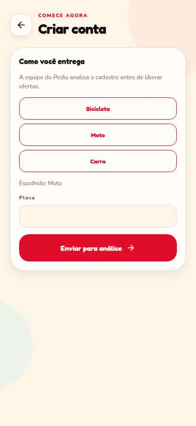

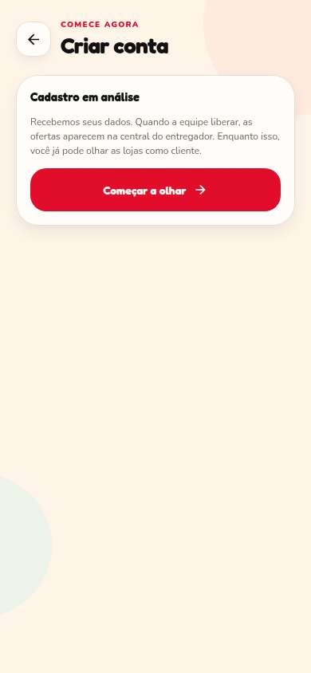

A Bia, ainda sem aprovação, abre a central e só vê “Seu cadastro está em análise” e o número da conta. Não há prazo, não há lista do que falta, não há como mandar documento.

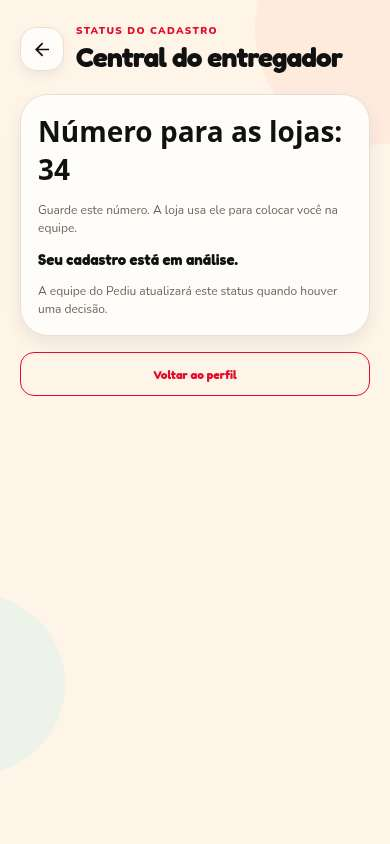

No admin, a Bia aparece com Aprovar e Rejeitar. O próprio texto diz que nenhum documento é mostrado, porque nenhum foi pedido. Aprovar é um toque. O Carlos já aprovado pode ser suspenso.

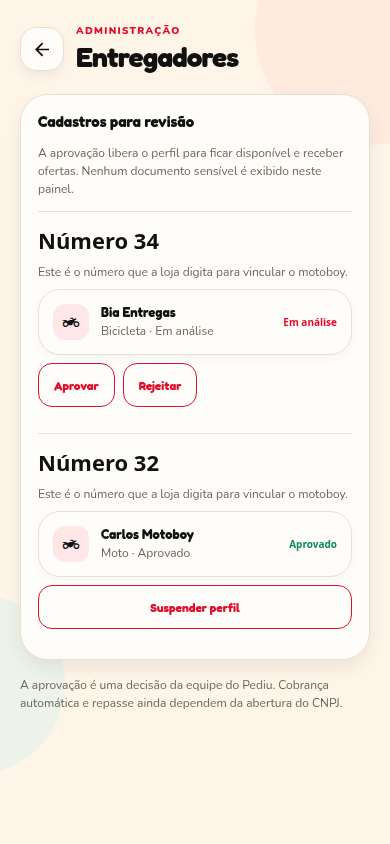

Enquanto espera, a pessoa não recebe oferta. Isso está certo. O que falta é a análise ser uma análise.

### Ficar online

O Carlos aprovado vê Offline no topo. Um toque muda para Online. Outro toque volta. Não há turno, não há zona, não há “estou na região de Pinheiros”. O número grande é o número interno da conta, para a loja digitar.

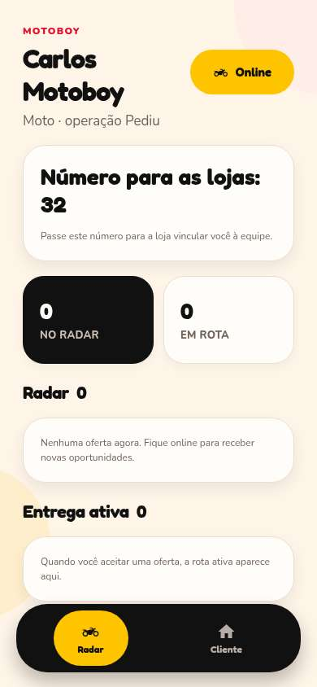

### A oferta

Quando a pizzaria chamou, o radar mostrou 1. O cartão dizia Pizzaria Forno da Vila, o endereço da Ana, um selo FLASH (o pedido era entrega padrão, não Flash), “Pedido R$ 48,90”, “ETA a combinar” e os botões Aceitar e Recusar.

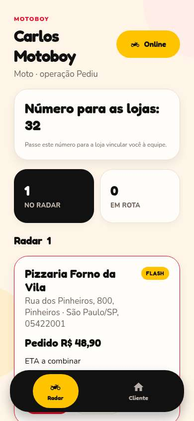

O que um app de motoboy mostra no lugar:

- segundos para aceitar, em contagem regressiva;
- quilômetros até a loja e até o cliente;
- o valor que o entregador recebe, separado do valor da pizza;
- o que é dinheiro a coletar na porta.

Aqui o R$ 48,90 é o total do cliente. O motoboy pode achar que aquele valor é o ganho dele. A oferta expira em 10 minutos no servidor, e a tela não mostra o relógio. Recusar existe; não testamos o recusar neste pedido para não perder a corrida. Não há repasse automático para outro motoboy da cidade.

### Rota, retirada e entrega

Depois do aceite a tela mostra o endereço da loja e o endereço da Ana em texto, o status Pronto e o botão “Iniciar rota e compartilhar GPS”. Não há “abrir no mapa”, Waze ou Google Maps. Não há um passo “retirei o pedido” separado da saída. Ao iniciar o GPS o status pulou para “A caminho”.

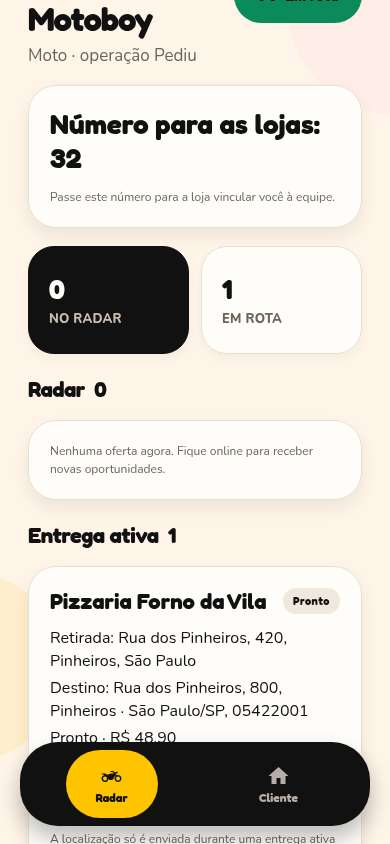

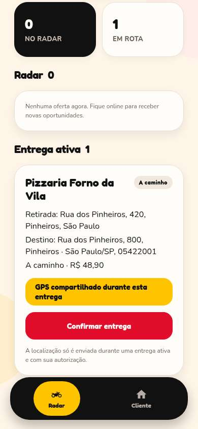

A localização neste teste foi permitida pelo navegador e enviada. No celular o programa pede permissão só com o app na frente, manda um ponto a cada 8 segundos ou 25 metros, e para quando a pessoa sai da tela. Não há localização com o app fechado ou a tela apagada. Bateria e segundo plano, que a Uber e o iFood tratam como parte do trabalho, não têm ajuste aqui.

Não há código de entrega, foto da porta, nome de quem recebeu nem “recebi o dinheiro”. O pagamento do pedido 2 continuou pendente no banco depois de a Ana já ver “entregue”.

Ao tocar em Confirmar entrega, a Ana passou a ver o pedido entregue. A tela do Carlos manteve “Em rota”, “A caminho” e Confirmar entrega, e escreveu uma frase de erro de programa: o envio da localização não conseguiu se desligar. Para o motoboy, a corrida não acabou.

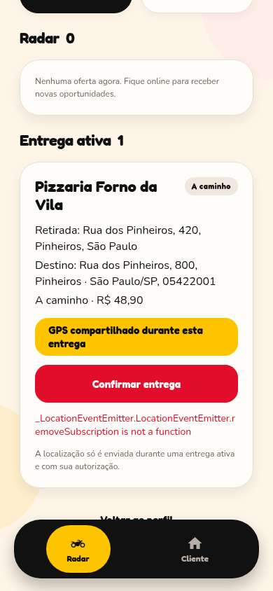

### Ganhos, várias corridas, cancelamento no meio

Não há tela de ganhos do dia, da semana ou de repasse. O admin avisa que cobrança automática e repasse dependem de CNPJ. A tela de vendas da loja também não registrou esse pedido.

A central mostra uma entrega ativa. Uma segunda corrida ao mesmo tempo não tem lugar na tela.

Se o cliente ou a loja cancela com o motoboy já na rua, não há aviso de cancelamento na rota nem pagamento de deslocamento. O pedido 1 morreu sozinho ainda na fila, antes de chamar alguém.

Se a internet cai no meio da entrega, a tela de acompanhamento da cliente está escrita para manter a última informação e oferecer “tentar novamente”. Isso não foi cortado no meio da rota do Carlos. Com o servidor inteiro sem resposta, a vitrine do cliente mostra o erro de catálogo citado acima. No plano gratuito, oferta vencida e aviso ficam parados até o servidor acordar.

---

## Admin

**Veredito: quase**, só para as três tarefas pequenas que existem. Não é uma mesa de operação de cidade.

O console lista pedidos pendentes, Flash, pagamentos, gorjetas, chamados e lojas. No teste, depois da entrega, a fila pendente estava em zero.

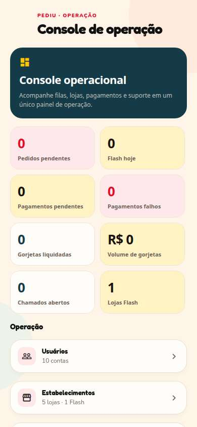

Aprovar e rejeitar motoboy funciona, como na seção do motoboy. Não há aprovação de loja antes de ela vender. Em Estabelecimentos o admin liga Flash, troca o tipo (restaurante, mercado, serviço) e abre ou fecha. A pizzaria, o lanche, o mercado e a feijoada apareceram abertos. A sushi apareceu fechada.

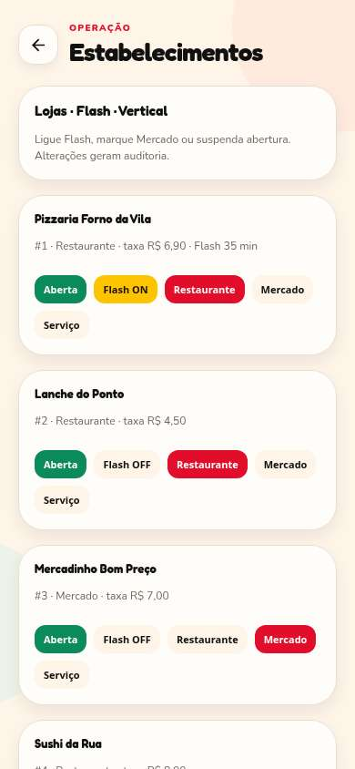

Pedidos mostra os dois do teste, com filtro por status. Dá para ver número, loja, cliente e valor. Não dá para ver o motoboy no mapa da cidade.

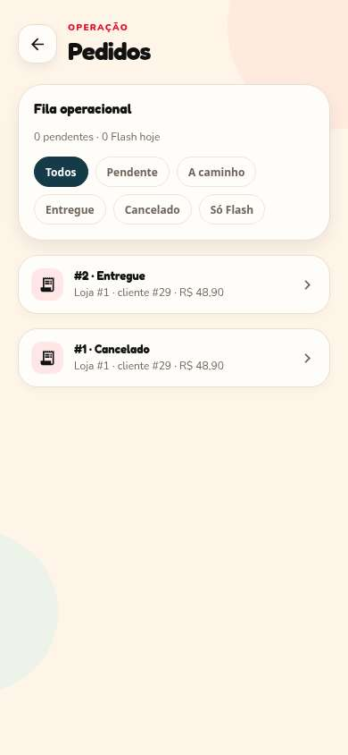

Em Usuários, o admin digita o e-mail e toca em Gerar código. Um código de 8 números aparece na hora, vale 30 minutos, e o Pediu não envia e-mail. Alguém precisa ler o código e passar para a pessoa. A tela deixa isso claro. O código deste teste não entra neste relatório.

---

## Lista do que mudar, na ordem

### Bloqueia piloto

1. **A introdução não deixa a pessoa entrar.** Pular e Começar devolvem a mesma tela até fechar e abrir o app. No iFood a vitrine abre na hora.
2. **Buscar “pizza” não acha a pizzaria.** A pessoa conclui que a cidade está vazia.
3. **Endereço digitado não vira um pino.** Sem pino não há pedido. Falta o mapa em que a pessoa arrasta o ponto, como em todos os apps da comparação. O GPS (“usar minha localização”) é a única saída oferecida, e no teste web o endereço escrito de Pinheiros falhou.
4. **Pedido parado 30 minutos é cancelado sem explicação.** A cliente só lê “cancelado”. Um app avisa “a loja não confirmou” e sugere outra loja.
5. **A aba Pedidos mostra fórmula em vez de frase.** `` `PEDIDO #$2` ``, loja como número e `` `R$ $48,90` ``. Isso sozinho passa a impressão de aplicativo inacabado.
6. **A oferta do motoboy está errada para quem vive de corrida.** Sem contagem, sem distância, sem valor do entregador, com o total da pizza no lugar do ganho e com selo FLASH num pedido comum. No iFood Entregas e na Loggi a pessoa decide em segundos com esses três números.
7. **Não há navegação até a loja nem até o cliente.** Só o endereço escrito. Falta abrir o mapa do celular. O “mapa” do cliente é um quadro cinza.
8. **Confirmar a entrega quebra a tela do motoboy.** A cliente vê entregue. O motoboy vê a corrida aberta e uma frase de erro. Falta também o passo “retirei na loja”, o código ou a foto na porta, e o “recebi o dinheiro”.
9. **Dinheiro na entrega não fecha o caixa.** Não pergunta troco. O pagamento continua pendente depois da entrega. Não há tela de ganhos do motoboy nem a venda entra no histórico da loja.
10. **A loja não é avisada.** Sem som de pedido novo. No navegador o aviso nem é tentado. Com o servidor gratuito dormindo, a oferta do motoboy também atrasa.
11. **Abrir a loja pede latitude e longitude e não pede horário.** Não há foto nem opção no produto. A loja fechada desaparece.
12. **Motoboy sem documento, e só recebe corrida se a loja souber o número da conta dele.** Não é uma praça de entregas da cidade. É uma lista particular de cada loja.

### Importante

- As boas-vindas prometem farmácia, mapa ao vivo e anúncio com IA. O que existe é comida, mercado, um quadro de texto e um atalho de divulgação.
- O visitante vê o lugar “Casa” sem ter casa salva.
- Todos os cartões usam o mesmo emoji. A pizza, na página do produto, usa outro emoji que não é comida.
- Não há nota da loja, tempo na vitrine nem pedido mínimo.
- Avaliação e chat existem e não são oferecidos no fim do pedido.
- Cancelar só aparece na aba Pedidos, e some quando o preparo começa. A ajuda não mostra essa regra com clareza.
- Uma segunda corrida ao mesmo tempo não cabe na central do motoboy.
- Cancelamento com o motoboy já a caminho não tem aviso nem compensação.
- A localização para quando o app sai da frente. Não há modo de economia de bateria.
- A loja nova não passa por aprovação. O admin só fecha depois, se alguém perceber.
- A senha nova depende de um humano ler um código. Isso serve para um piloto minúsculo com uma pessoa de confiança no admin. Não serve para a cidade.
- Com o servidor caído, a home ainda anuncia “até 25 min” e só no fim pede para tentar de novo.

### Melhoria

- Mascote, temas e o tom das frases. O carinho está lá. Pode ficar para quando o pedido fechar.
- Cupom, gorjeta, fiado, Flash e clube. São camadas em cima de um pedido que ainda não é confiável.
- Assistente por voz da loja.
- Respostas de ajuda mais concretas, com o número do pedido já escolhido.

---

## Veredito para começar na cidade

Não comece um piloto com cliente, loja e motoboy de verdade neste estado.

O esqueleto do pedido existe: olhar a loja, criar conta por papel, pagar em dinheiro quando o endereço já tem ponto, a cozinha aceitar e preparar, chamar um motoboy conhecido, ele aceitar e a cliente ver “entregue”. Isso é mais do que um desenho. Não é uma operação.

Para um piloto de um bairro, o mínimo que os apps de comparação já entregam no primeiro dia é: entrar sem laço, achar a loja pela busca, cravar o endereço no mapa, ver tempo e taxa antes de pedir, a cozinha ouvir o pedido, o motoboy ver distância e ganho e abrir o mapa, e os dois lados saberem que o dinheiro e a entrega acabaram. Hoje cada um desses pontos falha ou falta.

Nada disso foi corrigido neste relatório. As capturas estão ao lado deste texto.
